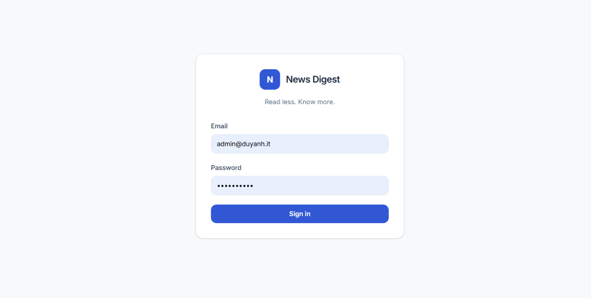
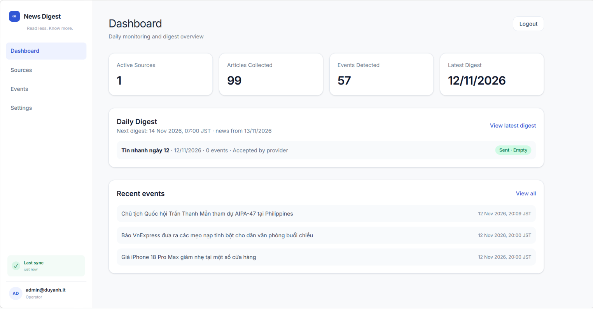
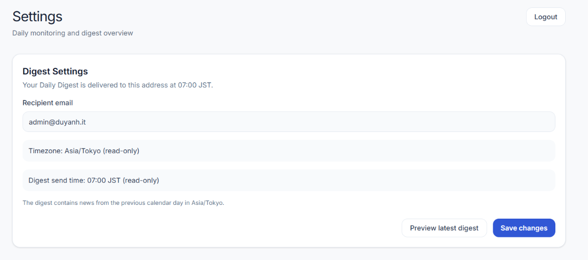

# AI Daily News Digest — Documentation

Documentation and onboarding guide for **AI Daily News Digest**.

## 🌐 Project

- **GitHub:** [Buiduyanh20/AIDailyNewsDigest](https://github.com/Buiduyanh20/AIDailyNewsDigest)
- **Production:** [https://digest.buiduyanh.io.vn](https://digest.buiduyanh.io.vn)
- **Health:** [https://digest.buiduyanh.io.vn/health](https://digest.buiduyanh.io.vn/health)
- **Readiness:** [https://digest.buiduyanh.io.vn/ready](https://digest.buiduyanh.io.vn/ready)

---

## 📚 Documentation

### 🏗️ Project

- [Project Overview](PROJECT_OVERVIEW.md)
  Product overview, architecture and technology stack.

- [Project Information](PROJECT_INFO.md)
  Repository, production services, domains, providers and important configuration.

### 👨‍💻 Developer

- [Developer Onboarding](DEVELOPER_ONBOARDING.md)
  Clone the project, install dependencies, configure `.env`, run migrations and start the application.

- [Secrets & Environment](SECRETS_AND_ENVIRONMENT.md)
  Environment variables, API keys, secrets and multi-machine development setup.

### 🚀 Production

- [Production Operations](PRODUCTION_OPERATIONS.md)
  Render, Neon, cron-job.org, monitoring, troubleshooting, backup and recovery.

- [Deployment Guide](deployment.md)
  Detailed production deployment instructions.

### 📐 Specifications

- [Product Specification v1.1](product-spec-v1.1.md)
  Product requirements and functional specification.

- [Technical Specification v1.1](technical-spec-v1.1.md)
  System architecture and technical design.

---

## 🖥️ Application

### Dashboard



### Sources



### Daily Digest Preview


---

## 🔄 System Flow

```text
RSS Sources
     ↓
Articles
     ↓
Gemini AI
     ↓
Events
     ↓
Daily Digest
     ↓
Resend
     ↓
Email
```

Production infrastructure:

```text
GitHub
   ↓
Render
   ↓
Neon PostgreSQL

cron-job.org
   ↓
Render
   ↓
RSS → Gemini → Digest → Resend
```

---

## 🔐 Security

These documents intentionally contain **no real credentials**.

Never commit:

- API keys
- passwords
- `DATABASE_URL`
- `SESSION_SECRET`
- `CRON_TRIGGER_TOKEN`
- `.env`

For environment configuration, see:

[Secrets & Environment](SECRETS_AND_ENVIRONMENT.md).

---

## 🚀 New Developer?

If this is your first time working with the project, start here:

**[→ Developer Onboarding](DEVELOPER_ONBOARDING.md)**

Recommended order:

```text
Developer Onboarding
        ↓
Project Overview
        ↓
Project Information
        ↓
Secrets & Environment
        ↓
Deployment Guide
        ↓
Production Operations
```

---

## 📝 Documentation Status

The documentation describes the current MVP architecture and production deployment.

When changing architecture, deployment, environment variables or operational procedures, update the relevant documentation together with the code.
